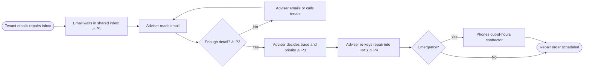

# 01. Current State and Problem

> **Practice case study.** Brookvale Homes is fictional and all figures are illustrative.

## 1. Context

| Item | Detail |
|---|---|
| Organisation | Brookvale Homes, a housing association in England, ~12,000 homes |
| Process | Tenants reporting repairs by email |
| Volume | ~2,600 repair emails a month (about 40% of all repair reports; the rest come by phone and the tenant portal) |
| Team | 2 contact centre advisers on the repairs inbox, plus cover from the phone team |
| Systems | Shared Outlook inbox; housing management system (HMS) for repair orders |
| Sponsor | Director of Property Services |

## 2. Current process

## 3. Baseline measures

| Measure | Current value | Source |
|---|---|---|
| Average time from email received to repair logged | 1.5 working days | Sample of 300 emails, last quarter |
| Emails needing a follow-up for more detail | ~25% | Same sample |
| Repairs logged with wrong trade or priority | ~12% | Contractor rejections and re-work log |
| Adviser time per email (read, decide, re-key) | ~6 minutes | Time-and-motion study, 2 days |
| Emergency repairs reported by email (instead of phone) | ~3% of emails | Same sample |
| Longest wait before an emergency email was read | 19 hours | Same sample |

## 4. Pain points

| ID | Pain point | Impact |
|---|---|---|
| P1 | Emails are read in date order, so urgent issues wait behind routine ones | Safety risk; possible breach of Awaab's Law timescales |
| P2 | A quarter of emails lack the detail needed (address, location in the home, photos) | Extra contact; delay |
| P3 | Trade and priority depend on each adviser's judgement | Inconsistent; ~12% re-work; contractor complaints |
| P4 | Details are re-keyed by hand from the email into the HMS | ~6 minutes per email; typing errors |

## 5. What's driving the change

- **Regulation.** Awaab's Law requires social landlords to deal with emergency hazards within 24 hours and to investigate damp and mould hazards within set timescales. An emergency sitting unread in an inbox is a compliance risk.
- **Consumer standards.** The Regulator of Social Housing's consumer standards expect landlords to deliver repairs effectively and to know which tenants are vulnerable.
- **Cost.** About 260 adviser hours a month go on the inbox.
- **Tenant experience.** Repairs are the top reason for complaints.

## 6. Problem statement

> *The problem of* manually reading and sorting repair emails in date order *affects* tenants, contact centre advisers and repairs contractors, *and results in* urgent hazards waiting too long, inconsistent priorities and wasted adviser time. *A good solution would* make sure emergencies are seen first, and give advisers a consistent starting point for every other email.
