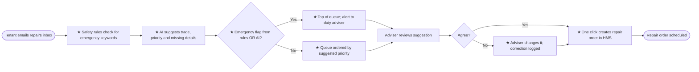

# 03. Requirements and Feasibility

> **Practice case study.** Brookvale Homes is fictional.

Requirements for option C (AI suggests, a person decides). Priorities use MoSCoW.

## 1. To-be process

★ = new or changed step. Every email is still checked by a person before a repair order is created.

## 2. Business requirements

| ID | Requirement | Priority |
|---|---|---|
| BR-01 | Every incoming repair email is checked against a list of emergency keywords and phrases (agreed with the Gas Safety and Building Safety leads) before any AI step. | Must |
| BR-02 | Emails flagged as possible emergencies, by the rules **or** the AI, go to the top of the queue and trigger an alert to the duty adviser within 5 minutes of arrival. | Must |
| BR-03 | For every email, the AI suggests a trade (e.g. plumbing, electrical, heating, damp and mould, carpentry, roofing, other) and a priority (emergency, urgent, routine). | Must |
| BR-04 | The AI's suggestion shows a confidence level, and low-confidence suggestions are clearly marked. | Must |
| BR-05 | An adviser must confirm or change every suggestion before a repair order is created. No repair order is created automatically. | Must |
| BR-06 | The AI lists missing details (e.g. address, which room, photos) so the adviser can ask for them in one go. | Should |
| BR-07 | When the adviser confirms, the repair order is created in the HMS with the email's details filled in, so nothing is re-keyed. | Should |
| BR-08 | Every suggestion, the adviser's decision and any change are logged for audit and for measuring accuracy. | Must |
| BR-09 | If the AI service is unavailable, emails fall back to the current process (safety rules still apply), and advisers are told. | Must |
| BR-10 | A weekly report shows volumes, suggestion accuracy, overrides by category, and time from email to repair order. | Should |
| BR-11 | Damp and mould reports are always tagged so they can be tracked against Awaab's Law timescales. | Must |

## 3. Non-functional requirements

| ID | Category | Requirement |
|---|---|---|
| NFR-01 | Data protection | Tenant data is processed only in the UK or EEA, under a data processing agreement that prevents the supplier from using it to train its models |
| NFR-02 | Data minimisation | Only the email subject, body and attachments are sent to the AI; tenant identifiers from the HMS are not |
| NFR-03 | Retention | AI inputs and outputs are kept for no longer than the repair record retention period |
| NFR-04 | Performance | Suggestions are ready within 60 seconds of an email arriving |
| NFR-05 | Explainability | Advisers can see why an email was flagged (keyword matched, or AI reason) |
| NFR-06 | Accessibility | The adviser screen meets WCAG 2.2 AA |

## 4. Feasibility

| Area | Assessment | Rating |
|---|---|---|
| **Technical** | Text classification of short emails is well established. The prototype in this repo reaches useful accuracy on synthetic data with a small open model. The HMS has an API for creating repair orders (to be confirmed with the supplier). | Feasible, with HMS API to confirm |
| **Data** | 12 months of historical emails with the trade and priority advisers chose can be used to test accuracy. They contain personal data, so testing must happen within the DPIA. | Feasible, subject to DPIA |
| **Operational** | Advisers keep the decision, so the change to their role is small. Training: about 2 hours. | Feasible |
| **Financial** | About £44,000 in year 1; payback in about 14 months on time saved alone (see [options appraisal](02-options-appraisal.md)). | Feasible |
| **Legal and regulatory** | No solely automated decisions about tenants (UK GDPR Article 22 not triggered). DPIA required because of new technology and possible special category data. | Feasible, with DPIA |

## 5. Open questions

| # | Question | Owner |
|---|---|---|
| Q1 | Does the HMS API support creating repair orders with attachments? | IT lead |
| Q2 | Use the HMS supplier's own AI add-on, or a separate service? | IT lead / procurement |
| Q3 | Who maintains the emergency keyword list, and how often is it reviewed? | Head of Building Safety |
| Q4 | How should emails in languages other than English be handled? | Head of Contact Centre |
