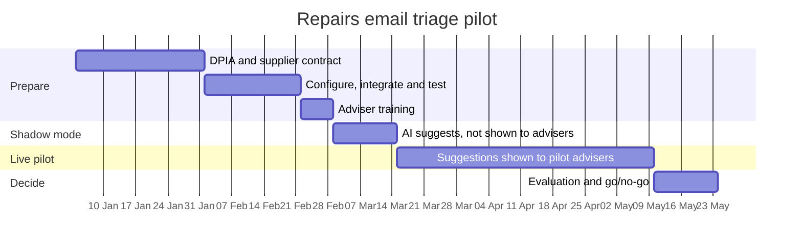

# 05. Success Measures and Pilot Plan

> **Practice case study.** Brookvale Homes is fictional and all figures are illustrative.

## 1. Success measures

| ID | Measure | Baseline | Pilot target | How measured |
|---|---|---|---|---|
| M1 | **Emergency emails flagged** (recall on emergencies) | Not measured | **100%** of emergencies confirmed by advisers were flagged by rules or AI | Weekly audit of all confirmed emergencies |
| M2 | Time from email received to emergency seen by an adviser | Up to 19 hours | Under 15 minutes in working hours | System timestamps |
| M3 | Time from email received to repair order created (all emails) | 1.5 working days | Under 0.5 working days | System timestamps |
| M4 | Adviser time per email | ~6 minutes | ~2 minutes | Time-and-motion sample, weeks 4 and 10 |
| M5 | Suggestion accuracy (trade and priority both correct) | – | 85% or more | Adviser confirmations vs changes |
| M6 | Repair orders with wrong trade or priority | ~12% | 5% or less | Contractor rejection and re-work log |
| M7 | Adviser override rate | – | 5–20% (outside this range, investigate) | Audit log |
| M8 | Adviser confidence in the tool | – | 70% or more agree it helps | Survey, weeks 6 and 12 |

**M1 is the gate.** If any confirmed emergency was not flagged, the pilot pauses until the cause is found and fixed. Too few overrides (M7) is treated as a warning sign: advisers may be accepting suggestions without checking.

## 2. Pilot plan (12 weeks)

| Phase | What happens | Exit criteria |
|---|---|---|
| **Prepare** | DPIA signed off; supplier contract; integration and test; emergency keyword list agreed; advisers trained | DPIA approved; UAT passed; M1 tested at 100% on 200 historical emergency emails |
| **Shadow mode** (2 weeks) | AI runs on live emails, but advisers don't see its suggestions. Its output is compared with what advisers decide. | M5 at 80% or more; M1 at 100% |
| **Live pilot** (8 weeks) | Two advisers see suggestions; one adviser works as now for comparison. Weekly review of M1–M7. | Measures tracked weekly; no unresolved M1 failures |
| **Decide** | Evaluation report to the sponsor and DPO | Go / adjust / stop decision |

## 3. Go/no-go criteria

| Decision | When |
|---|---|
| **Go:** roll out to all repair emails | M1 = 100%, M5 ≥ 85%, M3 and M4 targets met, no unresolved high risks |
| **Adjust:** extend the pilot for 6 weeks with changes | M1 = 100%, but M5 between 75% and 85% or time savings below target |
| **Stop** | M1 below 100% after fixes, or the DPO can't approve continued processing |

## 4. Rollout (if go)

1. All repair emails, with the same human review (month 1).
2. Add the structured web form, with AI suggestions shown to tenants for missing details (months 2–3).
3. Review whether the same approach suits other inboxes, e.g. complaints or anti-social behaviour. Each would need its own assessment and DPIA.

## 5. RACI

| Activity | Director of Property Services (sponsor) | Head of Contact Centre | BA | DPO | Head of Building Safety | IT lead | Advisers |
|---|---|---|---|---|---|---|---|
| Approve pilot | A | C | R | C | C | C | I |
| DPIA | I | C | R | A | C | C | I |
| Emergency keyword list | I | C | R | I | A | C | C |
| Configure and integrate | I | C | C | I | I | A/R | I |
| Train advisers | I | A | R | I | C | I | C |
| Weekly measures review | I | A | R | I | C | C | C |
| Go/no-go decision | A | R | R | C | C | C | I |
