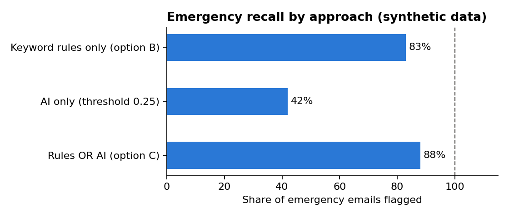

# Generative AI Adoption Assessment: Repairs Email Triage

> **Practice case study.** Brookvale Homes is a fictional housing association, all figures are illustrative, and the emails in the prototype are synthetic (written for this exercise, with no real tenant data). This repo shows how I would assess an AI tool for a business process. It is not based on client work.

An assessment of whether Brookvale Homes should use AI to sort and prioritise the repair requests that tenants send by email. It covers the current process, the options, feasibility, risks and UK GDPR, how success would be measured, and a pilot plan. A small prototype tests whether the idea works on sample data.

**Case study on my website:** a shorter write-up of this project is at [vinayakkoranga.com](https://vinayakkoranga.com/case-studies/genai-repairs-triage/).

## The business problem

Brookvale Homes manages about 12,000 homes. Tenants report around 2,600 repairs a month by email. Two contact centre staff read each email, decide what kind of repair it is and how urgent it is, and log it in the housing management system.

- Emails wait an average of **1.5 working days** before anyone reads them.
- About **1 in 8** are logged with the wrong trade or priority and have to be redone.
- Urgent issues (gas smells, no heating for vulnerable tenants, electrical hazards, serious damp and mould) sit in the same queue as routine requests. Since Awaab's Law came into force for social landlords in October 2025, missing an emergency hazard is a legal risk as well as a safety one.

## The question

> Can AI read incoming repair emails, suggest the repair category and urgency, and flag emergencies, so that staff confirm rather than start from scratch? And can it do that safely, lawfully and at a cost that makes sense?

## Recommendation (summary)

**Go ahead with a 12-week pilot of option C: AI suggests, a person decides.** The AI suggests a category and urgency for each email, a rules layer catches safety keywords so emergencies are never left to the model, and staff confirm every suggestion before it reaches the repairs system. Full automation (option D) is not recommended: the cost of a missed emergency is too high and the time saved over option C is small. Because the prototype shows that judging priority is not yet reliable, the pilot's first step is a test on real historical emails, and the AI's priority suggestions are only shown to staff if they pass.

Proceed only once the DPIA is signed off and the go/no-go measures in the [pilot plan](05-success-measures-and-pilot.md) are agreed.

## What the prototype found

A small prototype ([notebook](notebooks/triage_prototype.ipynb)) tested the idea on 120 synthetic emails using a free, open Hugging Face model:

| Measure | Result |
|---|---|
| Trade suggested correctly | 84% |
| Priority suggested correctly | 44% |
| Emergencies flagged by keyword rules only | 20 of 24 |
| Emergencies flagged by rules **or** AI | 21 of 24 |



Suggesting the trade works well, and that is where most of the adviser time saving comes from. Judging priority is much harder, and the combination still missed 3 emergencies. This supports two parts of the design: **an adviser checks every email**, and **the pilot starts in shadow mode**, testing on real historical emails before any suggestion is shown to staff.

## What's in the assessment

| # | Document | Status |
|---|---|---|
| 01 | [Current state and problem](01-current-state.md) | Done |
| 02 | [Options appraisal](02-options-appraisal.md): four options scored against weighted criteria | Done |
| 03 | [Requirements and feasibility](03-requirements-and-feasibility.md) | Done |
| 04 | [Risks, UK GDPR and DPIA screening](04-risks-and-data-protection.md) | Done |
| 05 | [Success measures and pilot plan](05-success-measures-and-pilot.md) | Done |
| – | [Prototype notebook](notebooks/triage_prototype.ipynb) and [synthetic data](data/) | Done |

## Run the prototype

```bash
python3 -m venv .venv
source .venv/bin/activate
pip install -r requirements.txt
jupyter notebook notebooks/triage_prototype.ipynb
```

The first run downloads the `all-MiniLM-L6-v2` model (about 90 MB) from Hugging Face.

## Tools

Markdown and Mermaid for the documents; Python and Hugging Face (sentence-transformers) for the prototype.
